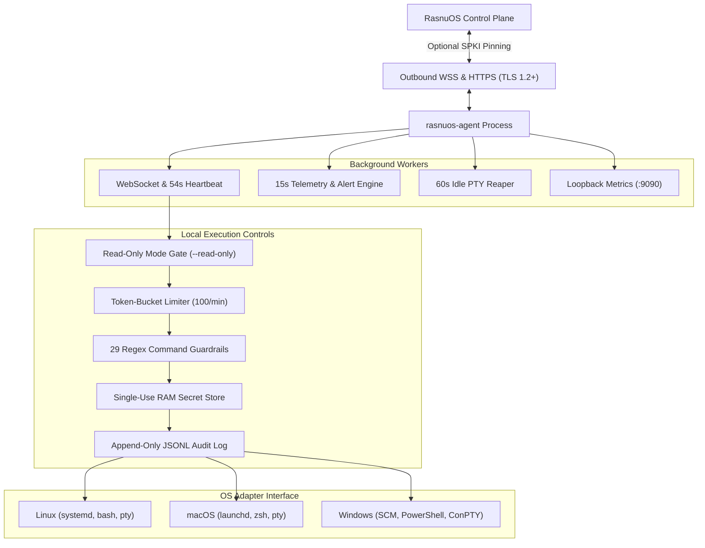
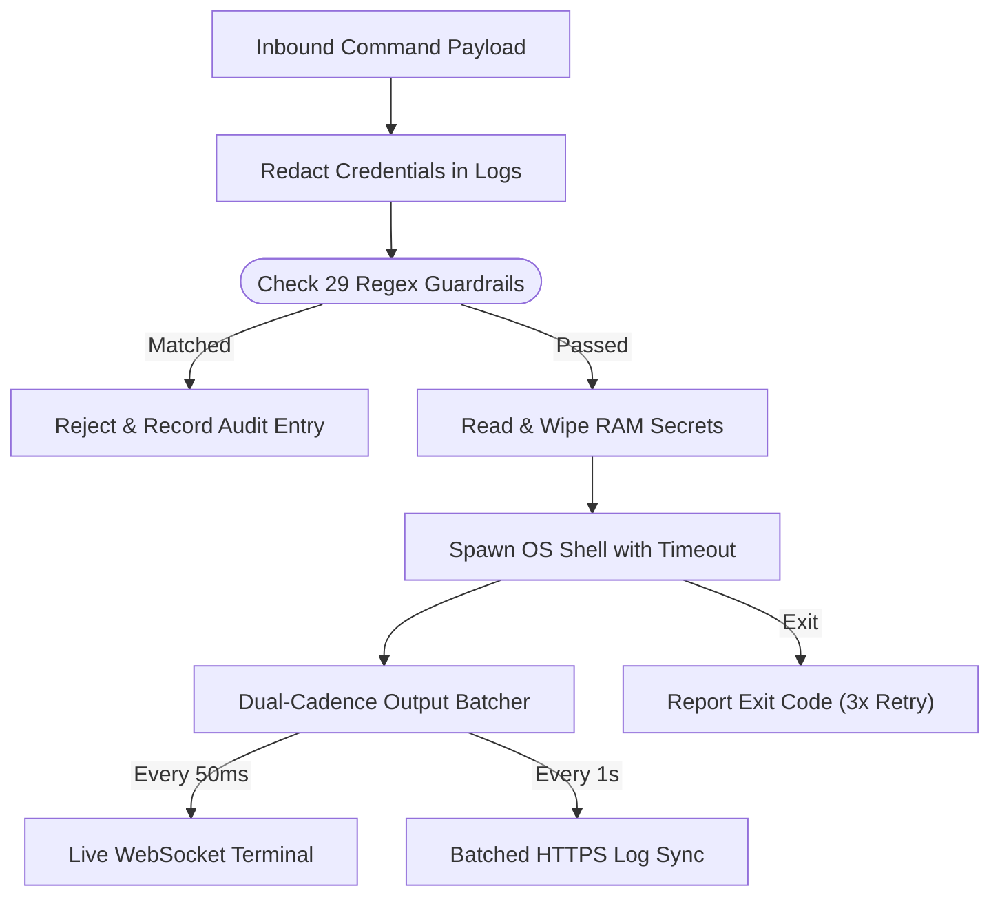
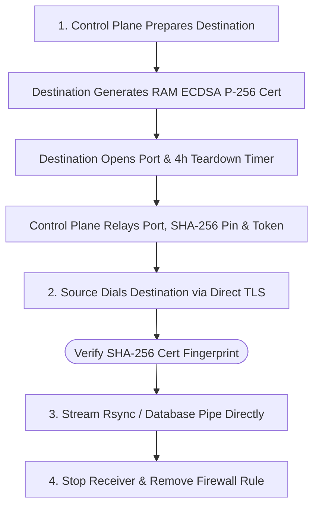
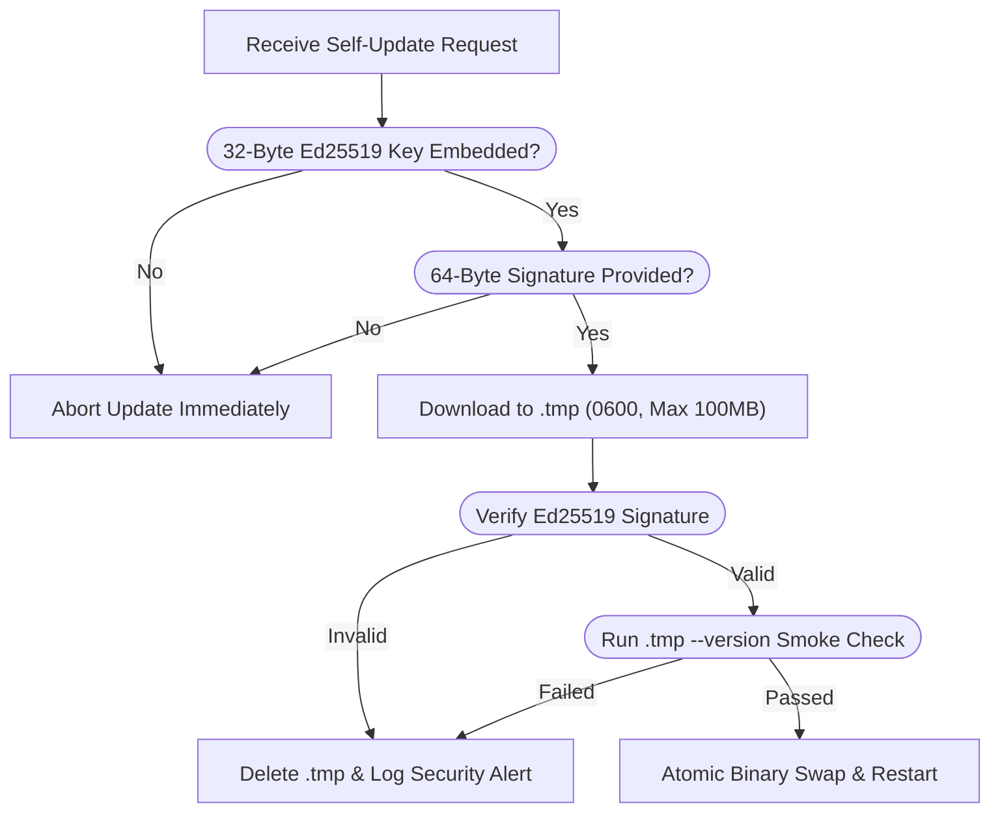
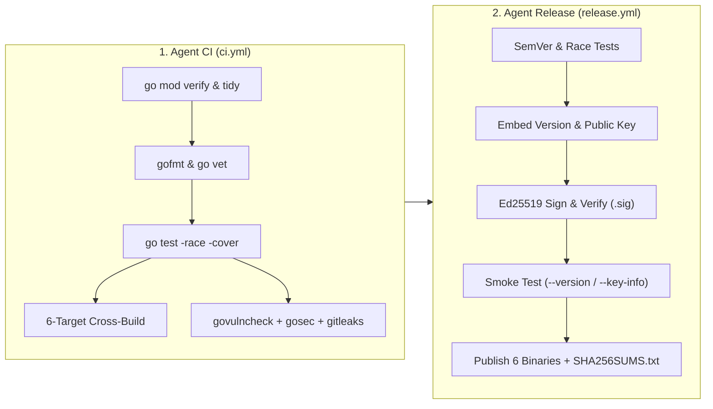

# rasnuos-agent

[](https://github.com/rasnu/os-agent/actions/workflows/ci.yml)
[](https://github.com/rasnu/os-agent/actions/workflows/release.yml)
[](go.mod)
[](#platform-support)
[](#building-and-verifying-releases)
[](LICENSE)

`rasnuos-agent` is the host daemon for [RasnuOS](https://os.rasnu.com). It is written in Go, compiles to a single static binary with `CGO_ENABLED=0`, and runs on Linux, macOS, and Windows across `amd64` and `arm64` architectures.

> [!IMPORTANT]
> **Source Availability & Security Auditing**  
> Because `rasnuos-agent` runs with system privileges on managed infrastructure, the complete source code is published in this repository for technical inspection. Infrastructure engineers and security teams can review the transport layer, inspect all 29 pre-execution command guardrails, verify official Ed25519 release signatures, or build the binary directly from source.  
> **License:** Distributed under the [Functional Source License (FSL-1.1-ALv2)](LICENSE), permitting source inspection, internal use, and non-commercial research while prohibiting competing commercial use.

---

## Contents

- [Overview](#overview)
- [Architecture](#architecture)
- [Subsystems](#subsystems)
- [Security Model](#security-model)
- [Command Guardrails (29 Rules)](#command-guardrails-29-rules)
- [Platform Support](#platform-support)
- [Local Observability & Audit Log](#local-observability--audit-log)
- [Configuration](#configuration)
- [Building and Verifying Releases](#building-and-verifying-releases)
- [CI/CD & Automated Security Pipeline](#cicd--automated-security-pipeline)
- [Directory Layout](#directory-layout)
- [License](#license)

---

## Overview

Traditional configuration management and deployment tools typically require opening inbound SSH ports (`22/tcp`) to internet-facing bastion hosts or storing long-lived private SSH keys in third-party control planes.

`rasnuos-agent` reverses that connection model. The daemon initiates **outbound-only** connections over TLS (`wss://` and `https://`) to the RasnuOS control plane. Managed hosts require no inbound firewall rules for normal orchestration and no static SSH keys on disk.

At runtime, the daemon maintains four background workers:

1. **WebSocket Event Loop & Heartbeat (`54s`)** — Subscribes to authenticated server channels, dispatches work to local executors, and monitors connection liveness.
2. **Telemetry & Alert Collector (`15s`)** — Samples host metrics, service states, and kernel OOM events, buffering snapshots in memory if network connectivity drops.
3. **PTY Session Reaper (`60s`)** — Cleans up interactive terminal sessions that have been idle for more than 30 minutes.
4. **Local Observability Server (`127.0.0.1:9090`)** — Exposes `/healthz` and Prometheus `/metrics` on the loopback interface for local monitoring agents.

---

## Architecture



### Process Lifecycle & Transport Details

- **Service Integration:** Runs as a `systemd` unit on Linux, a `launchd` daemon on macOS, and a Windows Service Control Manager (`svc.Handler`) service on Windows (`RasnuOSAgent`).
- **Graceful Shutdown (`10s` Deadline):** On `SIGINT`, `SIGTERM`, or Windows SCM `Stop`/`Shutdown`, the daemon sends a normal WebSocket close frame, closes active PTY sessions, cancels running command contexts, and waits up to 10 seconds for in-flight workers to flush output before exiting.
- **Forced IPv4 Dialing (`tcp4`):** The HTTP and WebSocket dialers in [`internal/transport/httpclient.go`](file:///home/theafaid/work/rasnuos/agent/internal/transport/httpclient.go) dial `tcp4` explicitly. This avoids connection timeouts on cloud instances where DNS returns `AAAA` records first but IPv6 egress routing is unconfigured.
- **Keep-Alive Tuning (`IdleConnTimeout: 5s`):** Connections stay warm during rapid 50ms log streaming bursts, while 15-second telemetry and 54-second heartbeats establish fresh sockets rather than reusing idle connections silently dropped by NAT gateways.
- **Reconnect Backoff:** Three consecutive ping or heartbeat failures trigger a reconnect using exponential backoff (`1s` base, `60s` cap) with `0–50%` random jitter.

---

## Subsystems

### 1. Command Execution & Output Streaming



- **Concurrency Limit:** Caps simultaneous command executions at `10` (`MaxConcurrentCommands = 10`).
- **Carriage-Return (`\r`) Scanner:** Splits output on both `\n` and `\r` (`64 KB` initial buffer, `1 MB` max token size) so progress indicators such as `rsync --progress` stream without buffering until a newline.
- **Pipe Drain Guarantee:** Waits for both `stdout` and `stderr` readers to reach `EOF` before calling `cmd.Wait()`, ensuring fast-exiting processes never drop trailing output lines.
- **Bounded Memory (`1 MB` `LogBuffer`):** Retains at most the trailing `1 MB` of output in memory per command to prevent runaway log output from exhausting host RAM.
- **Completion Retries:** Final exit status delivery retries up to 3 times with exponential backoff (`2s`, `4s`, `8s`) on transient network errors or `5xx` responses.

### 2. Interactive Terminal (PTY) & Stall Detection

- **Session Isolation:** Supports up to `5` concurrent interactive terminal sessions (`maxConcurrentSessions = 5`). Terminal IDs are validated against `^[a-zA-Z0-9_-]{1,64}$`, and sessions inactive for 30 minutes are terminated automatically.
- **Prompt Stall Detection:** For automated interactive workflows, a `500ms` ticker inspects recent terminal output to detect when a CLI tool is blocked waiting for user input:
  - **Prompt Heuristics (`>500ms` idle):** Matches common interactive suffixes including `[y/N] `, `password: `, `Password: `, `(yes/no) `, `Select: `, and `? `.
  - **Inactivity Fallback (`30s` idle):** Emits a stall notification if a command produces no output for 30 seconds while still running.

### 3. File Operations & In-Place Code Editing

- **Path Validation:** All file operations require clean, absolute paths (`filepath.IsAbs` and `filepath.Clean`). Root directory deletion (`/` or `C:\`) is rejected in code.
- **Transactional Multi-File Writes:** When writing a batch of files, new contents are staged in a temporary directory first and existing targets are backed up with their original `os.FileMode`. If any file fails to stage or commit, all modified targets are restored from backup automatically.
- **Chunked Transfers (`5 MB`):** Files larger than `5 MB` are transferred in `5 MB` chunks and verified against an `X-File-Hash` SHA-256 digest before moving into place.
- **In-Place File Patching (`internal/agent/ide_executor.go`):**
  - **Symlink-Resolved Path Jail:** Calls `filepath.EvalSymlinks` on target paths (and parent directories for new files) to prevent symlink traversal, blocking modifications to `/etc/`, `/usr/`, `/root/`, `/bin/`, `/sbin/`, `/var/`, `C:\Windows\`, and `C:\Program Files\`.
  - **Whitespace-Tolerant Matching:** Matches target blocks while ignoring trailing whitespace differences, applies multi-chunk replacements bottom-to-top, truncates and writes in place (`O_WRONLY|O_TRUNC`) to preserve file ownership and inodes, writes a `.bak_rasnuos_<timestamp>` backup copy, and returns a 3-line context unified diff.

### 4. Peer-to-Peer Migration & Reverse Tunnels

During server-to-server migrations, file and database streams travel directly between the source and destination hosts over an ephemeral TLS listener rather than routing payload data through the control plane:



- **Yamux Reverse Tunnels (`internal/agent/tunnel_engine.go`):** Hosts behind NAT or CGNAT can expose a local TCP service through a public relay host running `rasnuos-agent`. The tunnel multiplexes TCP streams over a single outbound TLS connection using HashiCorp Yamux (`github.com/hashicorp/yamux`), authenticated via SHA-256 certificate fingerprint pinning and a 64-byte token, with optional automatic Let's Encrypt TLS certificates (`golang.org/x/crypto/acme/autocert`) on port `443`.

### 5. Host Telemetry, Alerting & Log Tailing

- **15-Second Host Metrics (`internal/agent/metrics.go`):**
  - Collects CPU usage, RAM, disk utilization, swap usage, IO wait, 5-minute load average, CPU core count, cumulative network RX/TX bytes, disk read/write bytes, top 20 CPU processes, service states, and kernel OOM kill events.
  - **Bounded Offline Ring Buffer:** Retains up to `1,000` metric snapshots (~4.1 hours) during network outages. To keep memory usage under `~100 KB`, the buffer strips process lists, service arrays, and OOM slices from older queued entries while preserving numeric time-series metrics.
- **Debounced Threshold Alerts (`internal/agent/alert_monitor.go`):**
  - Resource thresholds (`CPU > 95%`, `RAM > 95%`, `Disk > 90%`, `Swap > 80%`, `IOWait > 50%`, `Load5 > 2.0x cores`) must remain breached for **3 consecutive 15-second ticks (`45s`)** before triggering an alert.
  - Service crashes (`Status == "failed"`) and kernel OOM kills bypass debouncing (`0 ticks`) and fire immediately, subject to a 15-minute cooldown between alerts.
- **Log Tailer (`internal/agent/log_tailer.go`):**
  - Tails configured log paths from `EOF`, groups multi-line stack traces, keeps a 50-line context ring buffer, matches error keywords (`error`, `fatal`, `panic`, `oom`, `segfault`, `denied`, `exception`, `critical`, `traceback`), deduplicates identical stack signatures over 10-second windows, truncates on valid UTF-8 rune boundaries (`10 KB` max), and masks credentials before transmission.

---

## Security Model

### Ed25519 Signed Self-Updates

The self-update mechanism in [`internal/agent/updater.go`](file:///home/theafaid/work/rasnuos/agent/internal/agent/updater.go) is fail-closed. If the binary was compiled without a valid 32-byte Ed25519 public key, or if the signature check fails, the update aborts before modifying the host binary:



### Summary of Security Controls

| Control | Source File | Implementation |
| :--- | :--- | :--- |
| **Read-Only Mode** | [`internal/agent/run.go`](internal/agent/run.go), [`pusher.go`](internal/agent/pusher.go) & [`file_manager.go`](internal/agent/file_manager.go) | Optional `--read-only` flag (`AGENT_READ_ONLY=true`) enforces zero-trust observability mode at the host level—permitting telemetry, service discovery, and read-only file listing while rejecting shell commands, IDE edits, file writes/deletions, service mutations, process kills, and interactive PTY sessions. |
| **TLS SPKI Pinning** | [`internal/transport/tlspin.go`](file:///home/theafaid/work/rasnuos/agent/internal/transport/tlspin.go) | Optional `--tls-pin` / `TLS_PIN` verifies `sha256(cert.RawSubjectPublicKeyInfo)` across the certificate chain on all WSS and HTTPS connections. Supports comma-separated pins for key rotation. |
| **Ed25519 Binary Verification** | [`internal/agent/updater.go`](file:///home/theafaid/work/rasnuos/agent/internal/agent/updater.go) | Verifies updates with `crypto/ed25519`, writes temporary files with `0600` permissions, enforces a `100 MB` download limit, and runs `--version` before swapping the executable. |
| **In-RAM Secret Store** | [`internal/agent/secret_store.go`](file:///home/theafaid/work/rasnuos/agent/internal/agent/secret_store.go) | Holds runtime secrets only in process memory, scopes each secret batch to a single step ID, deletes them on first read (`retrieveAndWipeSecrets`), and expires unread entries after 5 minutes. |
| **Credential Redaction** | [`internal/agent/executor.go`](file:///home/theafaid/work/rasnuos/agent/internal/agent/executor.go) & [`log_tailer.go`](file:///home/theafaid/work/rasnuos/agent/internal/agent/log_tailer.go) | Scrubs `-p<val>`, `--password=<val>`, `redis-cli -a <val>`, `*PASS*`/`*PWD*`/`*SECRET*`/`*AUTH*` assignments, `Bearer` tokens, and `sk_live_` keys prior to logging. |
| **Command Rate Limiting** | [`internal/ratelimit/ratelimit.go`](file:///home/theafaid/work/rasnuos/agent/internal/ratelimit/ratelimit.go) | Token-bucket limiter capping inbound command and PTY start events at `100/min` by default (`AGENT_RATE_LIMIT_PER_MINUTE`). Rejected requests are written to the local audit log. |
| **Input Validation** | [`internal/agent/pusher.go`](file:///home/theafaid/work/rasnuos/agent/internal/agent/pusher.go) & [`pty.go`](file:///home/theafaid/work/rasnuos/agent/internal/agent/pty.go) | Validates service names against `^[a-zA-Z0-9._@\-]+$`, PIDs against `^[0-9]+$`, and terminal session IDs against `^[a-zA-Z0-9_-]{1,64}$`. |

---

## Command Guardrails (29 Rules)

Before spawning a shell process, [`internal/guardrails/guardrails.go`](file:///home/theafaid/work/rasnuos/agent/internal/guardrails/guardrails.go) evaluates the command string against 29 pre-compiled regular expressions. Any match blocks execution immediately and returns `[GUARDRAIL BLOCK]`:

| Category | Rules | Blocked Patterns |
| :--- | :---: | :--- |
| **1. Filesystem Destruction** | 4 | • `rm` with recursive and force flags (`-rf`, `-fr`, `--recursive --force`) targeting `/` or `/*`<br/>• `rm` with `--no-preserve-root`<br/>• `find / ... -delete` at root depth<br/>• `shred` targeting `/dev/*` block devices |
| **2. Disk & Partition Wiping** | 5 | • `mkfs` / `mkfs.*` targeting `/dev/*`<br/>• `dd` writing to block devices (`of=/dev/sd*`, `nvme*`, `vd*`, `hd*`, `xvd*`, `mmcblk*`, `loop*`)<br/>• `wipefs`<br/>• `fdisk`, `parted`, `sfdisk`, `cfdisk`, `gdisk`, or `sgdisk` targeting `/dev/*`<br/>• Raw output redirection `> /dev/(sd\|nvme\|vd\|hd\|xvd)...` |
| **3. Fork Bombs** | 2 | • `:(){ :\|:& };:` bash fork bomb<br/>• Recursive shell function bombs (`foo() { foo \| foo & };`) |
| **4. Permission & Auth Lockout** | 3 | • Recursive `chmod -R (000\|777)` on `/`, `/etc`, `/usr`, `/var`, `/bin`, `/sbin`, `/lib`<br/>• Recursive `chown -R` on `/`<br/>• Overwriting or truncating `/etc/passwd`, `/etc/shadow`, `/etc/sudoers`, or `/etc/ssh/sshd_config` |
| **5. Kernel & Boot Tampering** | 3 | • Deleting `/boot` (`rm -rf /boot`)<br/>• Writing to `/proc/sysrq-trigger`<br/>• Loading raw kernel modules via `insmod` |
| **6. Remote Pipe Execution** | 2 | • `curl ... \| (sh\|bash\|zsh\|python\|perl)`<br/>• `wget ... -O- \| (sh\|bash\|zsh\|python\|perl)` |
| **7. Network & Firewall Lockout** | 3 | • `iptables -F` or `iptables -P INPUT DROP`<br/>• `ufw --force reset` or `ufw default deny incoming` without a prior SSH rule<br/>• `ip link set ... down` or `ifconfig ... down` on primary interfaces (`eth*`, `ens*`, `enp*`, `eno*`) |
| **8. Audit & History Tampering** | 1 | • Clearing or truncating `.bash_history`, `/var/log/auth.log`, `/var/log/syslog`, or `/var/log/messages` |
| **9. Windows Destructive Commands** | 6 | • `format C:`<br/>• `rd /s /q C:\`<br/>• `del /f /s /q C:\`<br/>• `Remove-Item C:\* -Recurse -Force`<br/>• `Clear-Disk`<br/>• `Stop-Computer` or `Restart-Computer -Force` |

---

## Platform Support

Platform-specific behavior is isolated behind the [`OSAdapter`](file:///home/theafaid/work/rasnuos/agent/internal/osadapter/adapter.go) interface using Go build tags (`linux`, `darwin`, `windows`):

| Capability | Linux (`linux.go`) | macOS (`macos.go`) | Windows (`windows.go` & `conpty_windows.go`) |
| :--- | :--- | :--- | :--- |
| **Command Shell** | `bash -c` (`su - <user> -c` when `runAsUser` is set) | `$SHELL -c` (fallback `/bin/zsh` → `/bin/bash`; `su - <user> -c`) | `powershell -NoProfile -NonInteractive -Command` |
| **Interactive PTY** | `creack/pty` (`bash`, `TERM=xterm-256color`) | `creack/pty` (`$SHELL` / `/bin/zsh`, `TERM=xterm-256color`) | Native Windows ConPTY (`CreatePseudoConsole` + PowerShell), fallback to line-buffered `cmd.exe` pipes |
| **Service Discovery** | 12 common daemons + `systemctl list-units --type=service --state=failed` | 8 common daemons (`pgrep -x`) + `launchctl list` non-zero exit check | 16 Windows services (`Get-Service`) + WMI `Win32_Service` crashed `Auto` services |
| **OOM Detection** | `dmesg -T` (`Out of memory: Killed process`), fallback `journalctl -k` | `log show` (`jetsam` / `low swap` over last 5m) | System Event Log (`Microsoft-Windows-Resource-Exhaustion-Detector`, Event ID 2004) |
| **Service Control** | `systemctl <start\|stop\|restart> <service>` | `brew services <action>`, fallback `launchctl kickstart/kill` | PowerShell `Start-Service` / `Stop-Service` / `Restart-Service` |
| **Scheduled Jobs** | `/etc/cron.d/rasnuos-jobs` (`0644`) + `systemctl restart cron` | Non-destructive managed block merge (`# BEGIN/END RASNUOS MANAGED JOBS`) in user `crontab` | Non-destructive managed block merge in `C:\ProgramData\RasnuOS\cron_job.ps1` (`0600`) + Windows Scheduled Task |
| **Firewall Rules** | `ufw allow/delete allow <port>/tcp`, fallback `iptables -I/-D INPUT` | No-op (`pfctl` requires full ruleset reload) | `New-NetFirewallRule` / `Remove-NetFirewallRule` |
| **Machine ID** | `/etc/machine-id` (fallback `/var/lib/dbus/machine-id`) | `ioreg -rd1 -c IOPlatformExpertDevice` (`IOPlatformUUID`) | Registry `HKLM:\SOFTWARE\Microsoft\Cryptography` → `MachineGuid` |
| **Application Log** | `/var/log/rasnuos-agent.log` | `/var/log/rasnuos-agent.log` | `C:\ProgramData\RasnuOS\Agent\rasnuos-agent.log` |

---

## Local Observability & Audit Log

Administrators can inspect agent health and audit every host operation locally without relying on the cloud dashboard.

### 1. Loopback Health & Prometheus Endpoint (`127.0.0.1:9090`)

Bound to `127.0.0.1:9090` by default (configurable via `METRICS_PORT` and `METRICS_BIND`; set `METRICS_PORT=off` to turn off):

- **`GET http://127.0.0.1:9090/healthz`** — Returns JSON liveness status (`200 OK`), agent version, and process uptime in seconds (`{"status":"ok","agent_version":"1.0.0","uptime_seconds":3600}`).
- **`GET http://127.0.0.1:9090/metrics`** — Exports Prometheus metrics (`agent_commands_total`, `agent_command_errors_total`, `agent_active_commands`, `agent_websocket_reconnects_total`, `agent_websocket_connected`, `agent_uptime_seconds`).

### 2. Local Security Audit Log (`internal/audit/audit.go`)

Every command execution, file modification, service action, process kill, PTY session event, migration/tunnel setup, self-update, and rate-limit rejection is appended to a local SHA-256 hash-chained JSON Lines (`JSONL`) file with `0600` permissions:

- **Linux:** `/var/log/audit.jsonl` (fallback `./audit.jsonl` when `/var/log` is not writable)
- **macOS:** `/var/log/audit.jsonl` (fallback `./audit.jsonl`)
- **Windows:** `C:\ProgramData\RasnuOS\Agent\audit.jsonl` (fallback `.\audit.jsonl`)

Example entry:
```json
{"timestamp":"2026-10-14T01:30:00Z","action":"execute_command","pipeline_id":"42","step_id":"108","command":"systemctl status nginx","run_as_user":"root","success":true,"prev_hash":"0000000000000000000000000000000000000000000000000000000000000000","hash":"8f4e2a..."}
```

### 3. Log Rotation

Application logs rotate automatically via `gopkg.in/natefinch/lumberjack.v2` (`MaxSize: 50 MB`, `MaxBackups: 3`, `MaxAge: 30 days`, `Compress: true`).

---

## Configuration

All CLI flags can also be supplied through environment variables ([`internal/agent/run.go`](file:///home/theafaid/work/rasnuos/agent/internal/agent/run.go)). In production service units, pass credentials via a `0600` environment file rather than CLI arguments so tokens are not exposed in process listings (`ps aux`):

| Flag | Environment Variable(s) | Required | Default | Description |
| :--- | :--- | :---: | :--- | :--- |
| `--token` | `BEARER_TOKEN` | **Yes** | — | Server authentication token. |
| `--server-id` | `SERVER_ID` | **Yes** | — | Unique server identifier. |
| `--api` | `API_URL` | No | `http://localhost:8000/api` | Control plane API base URL. |
| `--server` | `REVERB_SCHEME`, `REVERB_HOST`, `REVERB_PORT`, `REVERB_APP_KEY` | No | `ws://localhost:8080/app/...` | WebSocket endpoint URL (or constructed from `REVERB_*` variables). |
| `--read-only` | `AGENT_READ_ONLY` | No | `false` | Enforce read-only observability mode (`true` / `1` blocks all mutating commands, file edits, and PTY sessions). |
| `--tls-pin` | `TLS_PIN` | No | *(disabled)* | Comma-separated `sha256//<base64>` SPKI hashes for TLS pinning. |
| `--version` | — | No | `false` | Print `rasnuos-agent <version>` and exit. |
| `--key-info` | — | No | `false` | Print embedded Ed25519 update public key status and exit. |
| — | `AGENT_RATE_LIMIT_PER_MINUTE` | No | `100` | Maximum inbound commands allowed per minute. |
| — | `METRICS_PORT` | No | `9090` | Loopback port for `/healthz` and `/metrics` (`"off"` or `"disabled"` to turn off). |
| — | `METRICS_BIND` | No | `127.0.0.1` | Bind address for the local `/healthz` and `/metrics` listener. |

---

## Building and Verifying Releases

### 1. Inspect Binary Version & Embedded Public Key
```bash
./rasnuos-agent --version
./rasnuos-agent --key-info
```

### 2. Verify an Official Release Binary
Official release binaries include `SHA256SUMS.txt` and a detached Ed25519 signature (`.sig`). To verify a downloaded binary against the release public key:
```bash
# Check SHA-256 digest
sha256sum -c SHA256SUMS.txt --ignore-missing

# Verify Ed25519 signature
AGENT_PUBLIC_KEY="<BASE64_ED25519_PUBLIC_KEY>" \
  go run ./cmd/signer verify ./rasnuos-agent-linux-amd64 ./rasnuos-agent-linux-amd64.sig
```

### 3. Build from Source & Run Tests
Requires **Go 1.25+**:
```bash
# Run unit and race-detector tests
go test -v -race -count=1 ./...

# Build a single static binary for the current host
CGO_ENABLED=0 go build -trimpath -ldflags="-s -w" -o rasnuos-agent ./cmd/rasnuos-agent

# Cross-compile and Ed25519-sign all 6 OS/Arch targets (Linux, macOS, Windows × amd64, arm64)
./scripts/build-all.sh
```

---

## CI/CD & Automated Security Pipeline

Every commit, pull request, and tagged release passes through two automated GitHub Actions workflows in [`.github/workflows/`](.github/workflows):



### 1. Continuous Integration ([`.github/workflows/ci.yml`](.github/workflows/ci.yml))
Triggered automatically on pushes and pull requests to `main`, `develop`, and `master`:

| Job | Checks Performed | Failure Policy |
| :--- | :--- | :--- |
| **`Lint & Test (race detector)`** | • `go mod verify` & `go mod tidy` working-tree diff check<br/>• `gofmt -l .` formatting enforcement<br/>• `go vet ./...` static analysis<br/>• `go test -v -race -count=1 -coverprofile=coverage.out ./...`<br/>• Post-test `git status --porcelain` check (ensures tests leave zero untracked artifacts) | **Fail-closed** (blocks merge on any race condition, test failure, or unformatted file) |
| **`Cross-Platform Build`** | • Executes [`scripts/build-all.sh`](scripts/build-all.sh) across all 6 target triples (`linux/amd64`, `linux/arm64`, `darwin/amd64`, `darwin/arm64`, `windows/amd64`, `windows/arm64`)<br/>• Generates ephemeral Ed25519 test keys, signs all 6 binaries, and verifies every `.sig` signature | **Fail-closed** (blocks merge if any OS/Arch target fails to compile or verify) |
| **`Security Scans`** | • **`govulncheck`**: Analyzes reachable call paths against the Go Vulnerability Database<br/>• **`gosec` (SAST)**: Static Application Security Testing report published to the GitHub Step Summary<br/>• **`gitleaks` (`v8.21.2`)**: Full git history (`fetch-depth: 0`) secret and credential scanner | **Fail-closed** on `govulncheck` vulnerabilities and `gitleaks` secret detections |

### 2. Cryptographic Release Pipeline ([`.github/workflows/release.yml`](.github/workflows/release.yml))
Triggered when a GitHub Release is published or manually via `workflow_dispatch` with a semantic version input (e.g., `1.0.1`):

1. **Semantic Version & Race-Detector Gate:** Validates `X.Y.Z` tag format and runs `go test -race -count=1 ./...` before compiling.
2. **Fail-Closed Production Compilation (`RELEASE=1 ENV=production`):** Runs [`scripts/build-all.sh`](scripts/build-all.sh) with linker flags embedding both the version (`internal/buildinfo.Version`) and the 32-byte Ed25519 public key (`internal/agent.AgentPublicKeyBase64`).
3. **Detached Ed25519 Signing & Immediate Verification:** Signs each of the 6 compiled binaries using `cmd/signer` and `AGENT_PRIVATE_KEY` to produce `<binary>.sig`, then immediately runs `cmd/signer verify` against `AGENT_PUBLIC_KEY`. If `AGENT_PRIVATE_KEY` is missing in release mode, the pipeline aborts immediately so an unsigned release can never be published.
4. **Binary Smoke Checks:** Executes `./dist/rasnuos-agent-linux-amd64 --version` and `--key-info` in CI, asserting that the compiled binary reports the exact release version and `Update Public Key: configured (32-byte Ed25519)`.
5. **Artifact Publication:** Generates individual `.sha256` files and a consolidated `SHA256SUMS.txt` manifest, then uploads all 19 release assets (`6 binaries + 6 .sig + 6 .sha256 + SHA256SUMS.txt`) to the GitHub Release via `softprops/action-gh-release@v3`.

### 3. Required Repository Secrets for Releases

| GitHub Secret | Format | Purpose |
| :--- | :--- | :--- |
| `AGENT_PUBLIC_KEY` | Base64-encoded 32-byte Ed25519 public key | Embedded into every compiled agent binary via `-ldflags` to verify future over-the-air self-updates. |
| `AGENT_PRIVATE_KEY` | Base64-encoded 64-byte Ed25519 private key | Used exclusively inside `release.yml` by `cmd/signer` to generate `.sig` detached signatures for all 6 platform binaries. |

---

## Directory Layout

```text
agent/
├── .github/
│   └── workflows/
│       ├── ci.yml           # Continuous integration (gofmt, go vet, race tests, 6-target build, govulncheck, gosec, gitleaks)
│       └── release.yml      # Automated Ed25519 signing, verification, and GitHub Release publishing
├── cmd/
│   ├── rasnuos-agent/       # Daemon entrypoint
│   └── signer/              # Ed25519 key generation, binary signing, and signature verification CLI
├── internal/
│   ├── agent/               # WebSocket client, command/PTY/file/IDE/migration/tunnel/telemetry workers
│   ├── audit/               # Append-only 0600 JSONL local security audit log
│   ├── buildinfo/           # Build version metadata injected via -ldflags
│   ├── guardrails/          # 29 pre-compiled destructive command regex rules
│   ├── observability/       # Loopback 127.0.0.1:9090 /healthz and Prometheus /metrics server
│   ├── osadapter/           # Platform implementations for Linux, macOS, and Windows (ConPTY & SCM)
│   ├── ratelimit/           # Token-bucket rate limiter
│   └── transport/           # Forced-IPv4 HTTP client and SHA-256 SPKI certificate pinning
├── scripts/
│   └── build-all.sh         # Multi-platform cross-compilation and Ed25519 signing script
├── CODE_OF_CONDUCT.md       # Contributor Covenant v2.1 code of conduct
├── CONTRIBUTING.md          # Development workflow, race-test gates, and architecture rules
├── LICENSE                  # Functional Source License (FSL-1.1-ALv2)
├── README.md                # Architecture, security model, and configuration reference
└── SECURITY.md              # Vulnerability disclosure policy, SLAs, and Ed25519 verification guide
```

---

## License

Copyright © 2026 Rasnu LLC (rasnu.com). All rights reserved.

Licensed under the **Functional Source License, Version 1.1, ALv2 Future License (`FSL-1.1-ALv2`)**. See [LICENSE](LICENSE) for the full license text.

- **Permitted:** Viewing, security auditing, compiling from source, internal deployment, non-commercial education, and non-commercial research.
- **Prohibited:** Commercial use in any product or service that competes with or substitutes for RasnuOS or `rasnuos-agent`.
